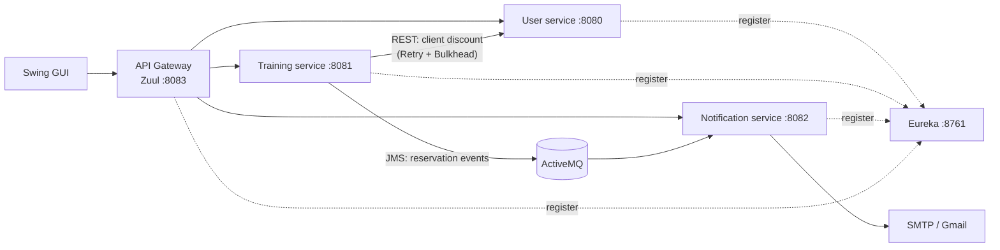

# Gym Microservices

Backend for a gym booking system, split into Spring Boot microservices behind a Zuul API gateway with Eureka service discovery. Clients can browse gyms and training sessions and book appointments; managers run their gym; admins manage users. Services talk to each other over REST and ActiveMQ.

Team project for a university course at the School of Computing (RAF), Belgrade, January 2024.

## Architecture



| Service | Folder | Port | Responsibility |
| --- | --- | --- | --- |
| Eureka server | `eureka_service` | 8761 | Service registry |
| API gateway | `api gateway` | 8083 | Single entry point (Zuul), CORS, routing by service id |
| User service | `korisnicki_servis` | 8080 | Clients, managers, admins; login and JWT issuing |
| Training service | `training_service` | 8081 | Gyms, training types, trainings, appointments, reservations |
| Notification service | `notification_service` | 8082 | Email notifications, notification history |
| GUI | `GUI` | – | Swing desktop client (login and registration screens) |

All services expose a REST API under `/api` and Swagger UI at `/api/swagger-ui.html`.

## What is implemented

- **JWT auth with roles.** The user service issues a token on login; each service checks it with a small AOP aspect (`@CheckSecurity(roles = ...)`) for `ROLE_ADMIN`, `ROLE_MANAGER` and `ROLE_CLIENT`.
- **Booking flow.** Making a reservation decreases appointment capacity, asks the user service for the client's discount and calculates the price, then publishes a JMS event to ActiveMQ meant for updating the client's reservation count.
- **Resilience.** The call from the training service to the user service is wrapped in Resilience4j Retry and Bulkhead.
- **Service discovery and routing.** Every service registers with Eureka; the gateway routes requests by service id.
- **Per-service layering.** Controller, service, repository, DTOs and hand-written mappers, with a common error response from a `@ControllerAdvice` handler.
- **H2 in-memory databases** with seed data, so each service starts without setup.

## Status

This is a course project and some parts were left unfinished:

- The JMS listeners in the notification service are written but commented out, and nothing consumes the reservation-count event yet, so emails are not sent.
- The hourly job that should cancel group trainings with fewer than three sign-ups is only a stub.
- The training service calls a `/client/{id}/discount` endpoint that the user service does not expose yet.
- The Swing GUI has login and registration screens but is not connected to the gateway.
- There are no tests beyond the generated context-load tests.

## Tech stack

Java 11, Spring Boot 2.2, Spring Cloud Hoxton (Netflix Eureka, Zuul), Spring Data JPA, H2, ActiveMQ (JMS), Resilience4j, JJWT, Springfox Swagger, Lombok, Maven, Swing.

## Running locally

Requirements: **JDK 11** (the Lombok version used does not compile on newer JDKs), Maven, and an ActiveMQ broker on `tcp://localhost:61616`.

```bash
# ActiveMQ, for example with Docker
docker run -d --name activemq -p 61616:61616 -p 8161:8161 rmohr/activemq

# start the services in this order, each in its own terminal
cd komponente_projekat/eureka_service       && mvn spring-boot:run
cd "komponente_projekat/api gateway"        && mvn spring-boot:run
cd komponente_projekat/korisnicki_servis    && mvn spring-boot:run
cd komponente_projekat/training_service     && mvn spring-boot:run
cd komponente_projekat/notification_service && mvn spring-boot:run
```

Optional environment variables:

| Variable | Used by | Default |
| --- | --- | --- |
| `EUREKA_URI` | all services | `http://localhost:8761/eureka` |
| `JWT_SECRET` | user, training, notification | `secret_key` (demo only, must be the same in all three) |
| `MAIL_USERNAME`, `MAIL_PASSWORD` | notification service | empty, set them to a Gmail address and an app password to send mail |

The user service seeds two demo admins (`admin` / `admin` and `admin2` / `admin`).

## Team

- **Stefan Milić** ([@Milki19](https://github.com/Milki19)): training service (gyms, appointments, reservations, Resilience4j), notification service, Eureka and API gateway setup
- **Aleksandar Čumić** ([@AleksandarCumic](https://github.com/AleksandarCumic)): user service (clients, managers, admins, login), GUI
- **Anđela Nikolić**: fixes across the services
